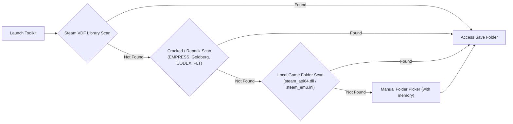

# RE8-Save-Toolkit

<div align="center">


-0078D4?style=for-the-badge&logo=windows11)


**A modern, responsive, and standalone Save Data Manager, Slot Deleter & Customization Toolkit for Resident Evil Village.**

[Features](#-key-features) • [Installation](#-installation) • [Detection Engine](#-smart-detection-engine) • [Cheats Submenu](#-customization--cheats-submenu) • [Supported Languages](#-supported-languages-i18n) • [Building](#-build-from-source)

</div>

---

## 📖 Overview

In **Resident Evil Village**, players have long faced a frustrating limitation: the game provides no built-in mechanism to delete individual typewriter save slots. Over time, slots accumulate, cluttering the save list with no way to organize or prune them without manually manipulating raw files or risking Steam Cloud conflicts.

**RE8-Save-Toolkit** is designed to solve this problem completely. Built from the ground up with **C# (.NET 8)**, **WPF**, and **Fluent Design (Windows 11 Mica)**, it delivers a clean, blazingly fast, and fail-safe desktop application to manage your saves, remove unwanted slots, back up progress, and safely customize in-game attributes through an advanced Cheats toolkit.

> [!NOTE]
> **Safety First:** The toolkit automatically creates timestamped backups in a dedicated `_backups/` folder before every delete or modification operation. Your original save progress is never at risk.

---

## ✨ Key Features

### 🗃️ 1. Complete Save Data Management
- **Individual Slot Deletion:** Easily remove specific typewriter slots (`data001Slot.bin`, `data002Slot.bin`, etc.) with a single click.
- **Detailed Slot Inspection:** View save slot index, last modified timestamp, file size, and save status.
- **Automated Pre-Action Backups:** Every modification automatically creates a clean backup before applying changes.
- **1-Click Full Backup & Restore:** Export your entire save folder to a compressed archive or restore previous states instantly.
- **Steam Cloud Conflict Prevention:** Built-in guidance and metadata handling to prevent Steam Cloud from overwriting deleted slots.

### ⚡ 2. Customization & Cheats Submenu
A dedicated sub-menu allowing granular customization of your save attributes:
- **Currency & Rewards:**
  - **Lei (Money) Modifier:** Adjust your current wallet balance or trigger the preset maximum (99,999,999 Lei).
  - **CP (Completion Points):** Edit your Challenge Points for the Extra Content Shop.
- **Extra Content Shop Unlocker:**
  - Unlock all figurines, concept art galleries, special weapons, and bonus game modes in `data00-1.bin` in seconds.
- **Combat & Survival:**
  - Max Health and Stamina toggles.
  - Infinite Ammo & No-Reload adjustments.
- **Inventory & Crafting:**
  - Maximum crafting materials (Gunpowder, Rusted Scrap, Chem Fluid, Herb).
  - Max Lockpicks and First Aid Meds.
- **The Mercenaries Mode:**
  - Adjust score records and ranks (SS / SSS) per stage.

---

## 🔍 Smart Detection Engine

The toolkit eliminates the need to manually hunt for obscure directories by combining a multi-tiered discovery pipeline:



### Supported Environments:
1. **Official Steam:**
   - Automatically reads `libraryfolders.vdf` and `appmanifest_1196590.acf` to find the game path.
   - Detects the active Steam user (`ActiveUser`) from the Windows Registry to locate `<SteamPath>\userdata\<ID>\1196590\remote\win64_save\`.
2. **Cracked & Repack Releases:**
   - **EMPRESS:** `%APPDATA%\EMPRESS\1196590\remote\...\win64_save\`
   - **Goldberg Steam Emulator:** `%APPDATA%\Goldberg SteamEmu Saves\1196590\remote\win64_save\`
   - **CODEX / RUNE:** `C:\Users\Public\Documents\Steam\CODEX\1196590\remote\win64_save\`
   - **FairLight (FLT):** `%APPDATA%\FairLight\1196590\remote\win64_save\`
   - **Portable Repacks:** `<GameRoot>\save\win64_save\` or `<GameRoot>\steam_settings\saves\`.
3. **Emulator Configuration Parsing:**
   - If `steam_api64.dll` is found in the game root, the toolkit automatically checks adjacent configuration files (`steam_emu.ini`, `CreamAPI.ini`) to extract the exact `AccountId` and `SavePath`.
4. **Windows Access Override:**
   - Automatically enables `SeBackupPrivilege` and `SeRestorePrivilege` to ensure seamless read/write access even in protected directories (`C:\Program Files (x86)`).
   - Clears read-only attributes (`FILE_ATTRIBUTE_READONLY`) seamlessly.
5. **Manual Directory Selection:**
   - Manual browse buttons with persistent memory (`app_config.json`) for custom or portable configurations.

---

## 🎨 Fluent Design & Responsiveness

- **Native Windows 11 Aesthetics:** Clean dark theme with Mica/Acrylic materials and refined amber/gold accents (`#D4AF37`) evoking the aesthetic of the Duke.
- **Full Screen & Dynamic Scaling:**
  - Press **F11** or click the title bar button to toggle Full Screen mode.
  - Fully responsive layout: all cards, typography, controls, and grids scale dynamically across 1080p, 1440p, 4K, and Ultrawide displays (16:9, 16:10, 21:9).

---

## 🌍 Supported Languages (i18n)

The toolkit features an integrated internationalization engine that automatically detects your Windows display language upon launch, while providing an instant manual language switcher in the header:

| Language | Region | Status |
| :--- | :--- | :---: |
| **Español Latinoamericano** | 🇲🇽 / 🌎 Latino / MX | Native Translation (Prioritario) |
| **English** | 🇺🇸 US / Global | Native Translation |
| **Português do Brasil** | 🇧🇷 Brazil | Complete |
| **Français** | 🇫🇷 France | Complete |
| **Deutsch** | 🇩🇪 Germany | Complete |
| **Italiano** | 🇮🇹 Italy | Complete |
| **日本語** | 🇯🇵 Japan | Complete |

> Translations are strictly localized using authentic Resident Evil Village terminology (e.g., *Máquina de escribir*, *Puntos de desafío (CP)*, *El Duque*, *Lei*), preventing generic machine-translation ambiguities.

---

## 🚀 Installation & Requirements

- **Operating System:** Windows 10 (1903+) or Windows 11 (x64)
- **Runtime:** .NET 8.0 Runtime (or download the Self-Contained standalone executable, which requires no external dependencies).
- **Target Game:** Resident Evil Village (Steam or standalone).

1. Download the latest `RE8-Save-Toolkit.zip` from the [Releases](https://github.com/XssentialPilar/RE8-Save-Toolkit/releases) page.
2. Extract the archive anywhere on your PC.
3. Launch `RE8-Save-Toolkit.exe`.

---

## 🛠️ Build from Source

Requirements:
- Windows 10/11 x64
- [.NET 8.0 SDK](https://dotnet.microsoft.com/download/dotnet/8.0)
- Visual Studio 2022 (with *.NET desktop development* workload)

Clone the repository and build:

```powershell
git clone https://github.com/XssentialPilar/RE8-Save-Toolkit.git
cd RE8-Save-Toolkit

# Build in Release configuration
dotnet build -c Release

# Publish as a single-file, self-contained executable
dotnet publish -c Release -r win-x64 --self-contained true -p:PublishSingleFile=true -o ./publish
```

---

## ⚖️ License & Disclaimer

This project is licensed under the **MIT License** — see the [LICENSE](LICENSE) file for details.

*Resident Evil Village* is a registered trademark of **Capcom Co., Ltd.** This project is an independent fan-made utility and is not affiliated with, endorsed by, or associated with Capcom. No copyrighted game assets or binaries are distributed within this repository.
